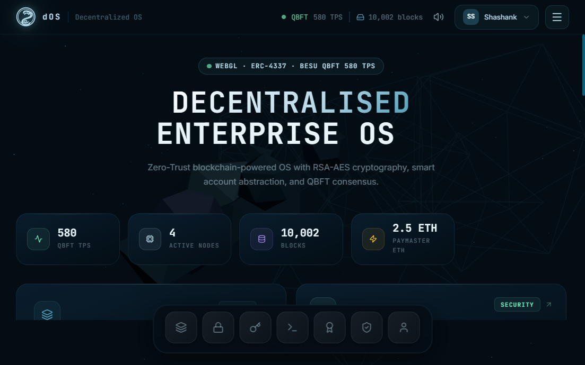

# dOS — Decentralized Enterprise Workspace for Secure Project Management and Data Verification

A modern enterprise-grade dashboard that demonstrates how secure project workflows can be designed using blockchain-inspired infrastructure, smart account authentication, encrypted file storage, and transparent project auditing.

This project presents a fictional but realistic ecosystem where users manage files, verify integrity, track milestone releases, monitor blockchain activity, and audit smart contracts using a desktop-style operating system interface.

## Project Overview

The dOS platform is built around a core idea: enterprise data should be protected by both cryptographic security and transparent blockchain verification. Instead of relying on a single centralized system, the application simulates a layered architecture combining:

- Smart account authentication with ERC-4337-style access control
- WebAuthn-style passkey sign-in experience
- RSA-AES hybrid file encryption
- SHA-256 integrity validation
- Sharded off-chain storage simulation
- QBFT blockchain transaction and block monitoring
- Project milestone budgeting and approvals
- Smart contract security analysis and audit results

The entire experience is designed to look like an OS workspace, making the platform feel more interactive and enterprise-ready.

## Showcase


Go Live - https://shashanksharmabad122.github.io/Decentralized-Enterprise-Workspace-for-Secure-Project-Management-and-Data-Verification/

## Key Features

### 1. Secure Authentication
- Smart Account-based access model
- Passkey-like user authentication experience
- Paymaster-supported gas sponsorship simulation
- ERP-like enterprise admin identity workflow

### 2. Encrypted File Vault
- File upload and encryption simulation
- RSA public-key wrapping of AES session keys
- SHA-256 hash generation for integrity verification
- Tamper detection and validation against blockchain records

### 3. Blockchain Explorer
- Block history and transaction monitoring
- QBFT consensus simulation
- TPS and block statistics dashboard
- On-chain-style record tracking for files and actions

### 4. Project Milestone Management
- Milestones with budgets, status, due dates, and approvals
- Release and validation flow for allocated project budgets
- Contract transaction links and milestone proof tracking

### 5. Security Audit Scanner
- SCSVS-style smart contract security checks
- Reentrancy protection detection
- Access control validation
- Arithmetic safety compliance review

### 6. Enterprise Workspace UI
- Desktop-like interface with windows, taskbar, and navigation
- Responsive layout for desktop and tablet use
- Animated hero section and cyber-modern dashboard aesthetic

## Architecture Summary

The system is structured into the following layers:

- Frontend: React + TypeScript + Vite
- UI Design: glassmorphism / enterprise OS aesthetic
- Backend: Express server with mock API endpoints
- Security Layer: RSA-AES hybrid encryption + SHA-256 hashing
- Blockchain Simulation: QBFT blocks, transactions, and ledger history
- Storage Layer: sharded database simulation across multiple nodes
- Smart Contract Layer: Hardhat + Solidity contract demos

## Tech Stack

- React 19
- TypeScript
- Vite
- Express.js
- Node.js
- Hardhat
- Solidity
- Crypto APIs for RSA/AES encryption
- Lucide icons and motion styling

## Repository Structure

```text
.
├── contracts/                  # Solidity smart contracts
├── test/                      # Smart contract tests
├── src/                       # Frontend application code
├── docs/                      # Project documentation and showcase screenshot
├── electron/                  # Electron desktop files
├── android/                   # Capacitor Android project
├── public/                    # Static public assets
├── scripts/                   # Blockchain-related scripts
├── artifacts/                 # Build artifacts
├── server.ts                  # Express mock backend
├── package.json               # Project scripts and dependencies
├── hardhat.config.cjs         # Hardhat configuration
├── vite.config.ts             # Vite configuration
├── README.md                  # Project documentation
└── .env.example               # Environment template
```

## Run Locally

### Prerequisites
- Node.js 18+ recommended
- npm

### Installation

```bash
npm install
```

### Start the development server

```bash
npm run dev -- --host 0.0.0.0
```

If port 3000 is already in use, run the app on a free port:

PowerShell:

```powershell
$env:PORT = 3010
npm run dev -- --host 0.0.0.0
```

Unix/macOS:

```bash
PORT=3010 npm run dev -- --host 0.0.0.0
```

Then open:

```text
http://localhost:3010
```

## Available Scripts

```bash
npm run dev
npm run build
npm run start
npm run lint
npm run desktop:dev
npm run desktop:build
npm run mobile:build
```

## Use Cases

This system is suitable for demonstrating:

- Enterprise blockchain-based file verification
- Secure audit workflows for project data
- Smart contract security analysis in a UI environment
- Role-based project governance for distributed teams
- Data trust and integrity verification in modern digital systems

## Notes

This project is designed as a conceptual demonstration and prototype of how a secure enterprise workspace can combine decentralization, cryptography, and workflow automation in a user-friendly interface.

## Future Enhancements

- Real blockchain integration using a live network
- Persistent database storage instead of in-memory simulation
- Real file upload and encryption pipeline
- Role-based permissions with secure authentication backend
- Production-ready contract deployment and CI/CD automation

## License

This project is currently provided for academic and demonstration purposes. Please check with the repository owner before commercial reuse.

## Author

Shashank Sharma

This project is intended as a secure enterprise workspace and distributed trust showcase for academic project evaluation and technical demonstration.
